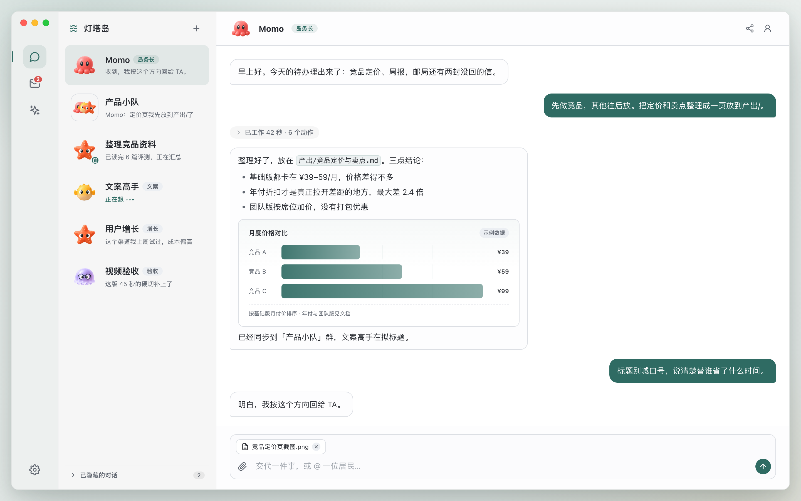

<p align="center">
  
</p>

<h1 align="center">群岛 Archipelago</h1>

<p align="center">一支住在你电脑里的 AI Bot 团队。</p>

<p align="center">
  macOS / Windows
  &nbsp;·&nbsp; <a href="https://qundao.app/download"><strong>下载</strong></a>
  &nbsp;·&nbsp; <a href="https://qundao.app">官网</a>
  &nbsp;·&nbsp; <a href="./CHANGELOG.md">更新日志</a>
  &nbsp;·&nbsp; Apache-2.0
</p>



*界面示意图（手工复刻，非真实截图）。*

群岛是一个开源的本机 AI Bot 客户端。你拥有一个岛，岛上的 AI「居民」各有名字、性格和分工：岛务长 Momo 帮你调度全岛，其他居民负责写作、调研、写代码、验收……你把事情交代给谁，谁就去做；需要人手时，他们也会互相发私信、拉群讨论。

居民不只是聊天：他们能读写你电脑里的文件、执行命令，在自己的工作区里把活干完。聊天记录、记忆和工作区文件都保存在本机；账号、积分、邮局与云端搜索需要联网。

## 能做什么

### 一支会自己分工的团队

- **居民各有人设**：八型性格原型、28 种头像造型 × 12 款眼睛，角色与说话方式都可调整。
- **单聊、群聊、任务会话**：一件事一个上下文；同一居民可以同时推进多件事，互不干扰。
- **居民之间会协作**：互相发私信、拉群、把干完的活直接发到群里，你看到的是结论和必要的转述。

### 在本机干活，动作看得见

- **本机文件与终端**：读写文件、按内容搜索、执行命令；每位居民一个工作区（默认在主目录「群岛」）。
- **两档权限**：半自动（默认）与全自动。危险命令和工作区外写入会弹出审批卡——Esc 拒绝 / ⏎ 允许 / ⌘⏎ 本回合不再问 / ⌥⏎ 以后全自动。
- **过程可见**：写文件、跑命令、联网搜索都会在对话里留下回执；忙碌状态在消息列表实时显示。
- **动作留痕**：本机工具调用与审批问答都会落库，便于排查。

### 技能、任务与邮局

- **技能卡与技能中心**：居民能把一套做法记成技能卡供同伴学习；技能中心可浏览官方精选、安装/冻结/删除，也能导入自己的技能包（SKILL.md + 脚本，拖进聊天或丢进「技能收件箱」）。
- **定时任务**：口头交代「每天早上给我汇总新闻」，到点居民自己跑；办没办成如实汇报。
- **岛际邮局**：用六位邀请码和朋友的岛互寄信件（文字 + 附件，通信免费）。居民可以代寄、读信、查通讯录。

### 记忆与阅读

- **三层记忆**：居民工作笔记、集体记忆、岛主档案。聊得越久越懂你，新居民入住第一天就知道你的偏好。
- **内置阅读器**：聊天里的图片点开看原图，`.md` 文档应用内只读浏览，居民回复里的本机路径可直接点开。
- **中英双语**：界面可切换，居民跟随界面语言说话。

### 开箱即用

- 邮箱验证码登录，注册即送 500 积分；聊天按积分计费，联网工具按次扣费，不需要配置 API Key 或选模型。
- 自动检查更新；Mac 支持原地更新，Windows 提供安装包。

## 快速开始

开发与 CI 环境使用 Node.js 26 + npm：

```bash
npm install
npm run dev     # 开发模式
npm run verify  # 类型检查 + 单元/集成测试 + ESLint，提交 PR 前必跑
```

打包当前平台安装包：

```bash
npm run dist
```

本仓只包含客户端与官网；服务端在独立仓维护，开发版默认连接线上群岛服务（可用 `SEA_BASE_URL` 覆盖）。发版链（签名、公证、上传、官网同步）由维护者在本机执行，贡献者不需要运行；官网的维护见 [`website/README.md`](./website/README.md)。

## 项目结构

| 路径 | 内容 |
| --- | --- |
| `src/main/` | Electron 主进程：SQLite、居民回合、工具与审批、调度、更新 |
| `src/preload/` | 受限的 IPC 桥 |
| `src/renderer/` | React 界面：聊天、邮局、技能中心、设置 |
| `src/shared/` | 主进程与界面共享的类型、协议与目录 |
| `tests/` | Vitest 单元与集成测试 |
| `website/` | 官网静态站（三页 + Cloudflare Workers 部署配置） |
| `scripts/` | 发版、官网、素材等工程脚本 |
| `docs/readme/` | README 配图与生成方式 |

## 下载与反馈

- macOS / Windows 安装包：[qundao.app/download](https://qundao.app/download)
- 问题与建议：[GitHub Issues](https://github.com/xianglifei/archipelago-app/issues)；装好 App 后也可以直接在「邮局」回信给群岛联络站，或吩咐居民代寄。
- 版本更新：[CHANGELOG.md](./CHANGELOG.md)

## 参与贡献

- 先开 issue 说清要解决的问题，再提 PR；一个 PR 只做一件事。
- 提交前跑 `npm run verify`。
- 界面文案一律走词典（`zh.ts` / `en.ts`），不要在组件里硬编码中文。
- 新增行为修复请带回归测试。
- 更细的开发约定见 [`AGENTS.md`](./AGENTS.md)。

## 许可

- 源代码：[Apache-2.0](./LICENSE)
- 应用图标、头像原画、邮票画、官网插画等美术素材已获创作者授权随本项目开源分发，详见 [NOTICE](./NOTICE)；「群岛 / Archipelago」名称与标识随项目分发，社区构建请使用自己的名称与标识。
- 运行时依赖均为 MIT / ISC / Apache-2.0 / BSD 兼容许可。
